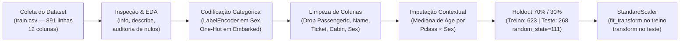
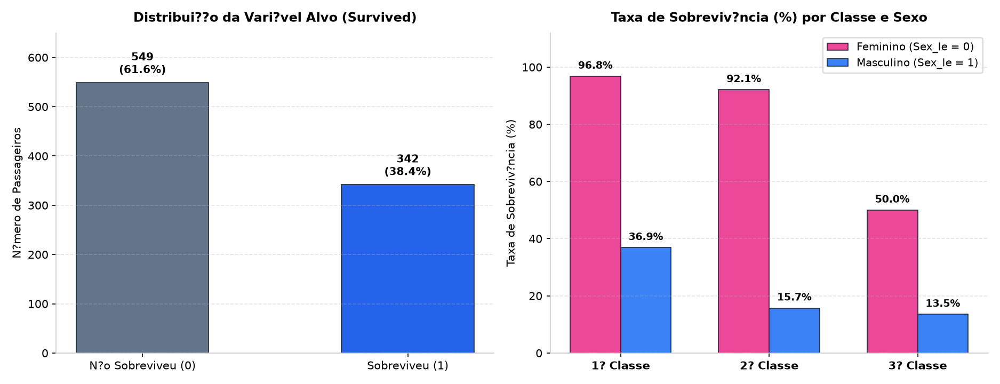
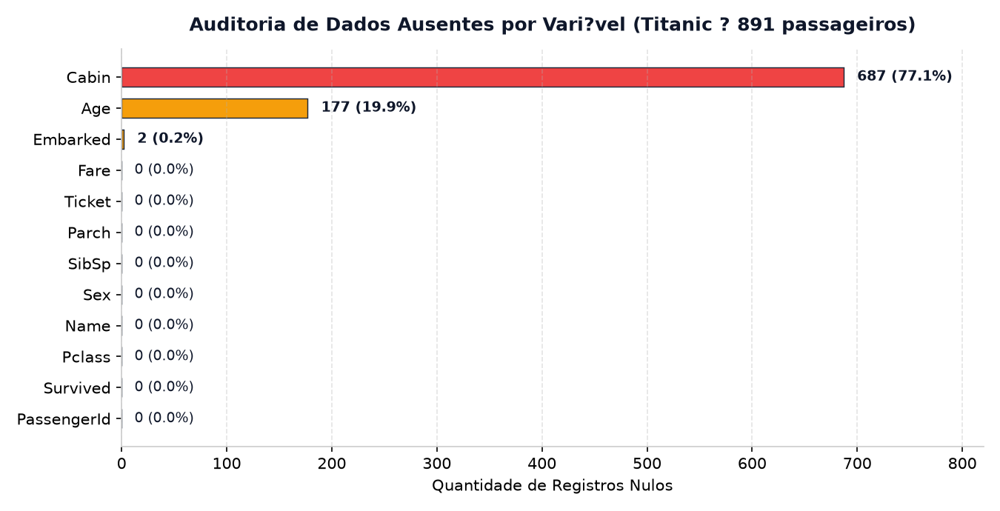
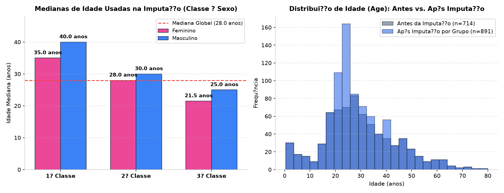
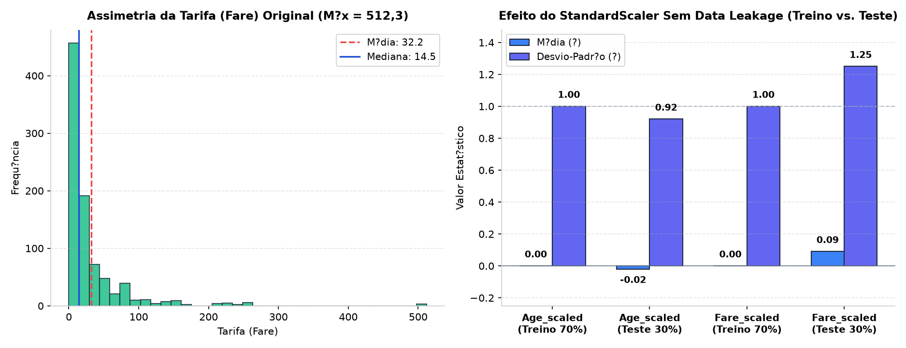

# Análise Exploratória e Pré-processamento do Dataset Titanic


Projeto acadêmico da disciplina de **Modelos Preditivos Clássicos** (Especialização em Engenharia e Análise de Dados — **CESAR School**), desenvolvido pela **Equipe 04**.

O notebook [`01_Equipe_04_EDA_Classificação_Titanic.ipynb`](./01_Equipe_04_EDA_Classifica%C3%A7%C3%A3o_Titanic.ipynb) realiza a inspeção estatística, codificação de variáveis categóricas, imputação contextual de dados ausentes, separação *holdout* e padronização sem vazamento de dados (*data leakage*), preparando o conjunto de dados do **RMS Titanic** para algoritmos de classificação supervisionada da variável `Survived`.

---

## Sumário

1. [Visão Geral e Fluxo de Pré-processamento](#1-visão-geral-e-fluxo-de-pré-processamento)
2. [Conjunto de Dados e Dicionário de Variáveis](#2-conjunto-de-dados-e-dicionário-de-variáveis)
3. [Análise Exploratória e Auditoria de Dados Ausentes](#3-análise-exploratória-e-auditoria-de-dados-ausentes)
4. [Engenharia de Atributos e Tratamento de Valores Nulos](#4-engenharia-de-atributos-e-tratamento-de-valores-nulos)
5. [Divisão Holdout e Padronização (`StandardScaler`)](#5-divisão-holdout-e-padronização-standardscaler)
6. [Conclusões e Próximos Passos](#6-conclusões-e-próximos-passos)
7. [Estrutura do Repositório](#7-estrutura-do-repositório)
8. [Como Executar](#8-como-executar)
9. [Equipe](#9-equipe)

---

## 1. Visão Geral e Fluxo de Pré-processamento

O pipeline implementado transforma a base bruta de passageiros (891 registros e 12 colunas heterogêneas) em matrizes numéricas íntegras e padronizadas de treino e teste:



---

## 2. Conjunto de Dados e Dicionário de Variáveis

O notebook lê o conjunto de treino clássico do Titanic diretamente de [agconti/kaggle-titanic](https://github.com/agconti/kaggle-titanic/blob/master/data/train.csv).

| # | Coluna Original | Descrição | Tipo Original | Não-Nulos | Tratamento Aplicado no Pipeline |
| :-: | :--- | :--- | :-: | :-: | :--- |
| 1 | `PassengerId` | Identificador sequencial do passageiro (1 a 891) | `int64` | 891 (100%) | **Removida** (identificador sem poder preditivo) |
| 2 | **`Survived`** | **Variável alvo:** `0` = Não sobreviveu, `1` = Sobreviveu | `int64` | 891 (100%) | Mantida como *target* (`y_train`, `y_test`) |
| 3 | `Pclass` | Classe socioeconômica do bilhete (`1`, `2` ou `3`) | `int64` | 891 (100%) | Mantida como variável ordinal |
| 4 | `Name` | Nome completo e título do passageiro | `object` | 891 (100%) | **Removida** (texto livre de alta cardinalidade) |
| 5 | `Sex` | Sexo biológico (`male` / `female`) | `object` | 891 (100%) | Codificada via `LabelEncoder` em **`Sex_le`** (`0` = female, `1` = male) |
| 6 | `Age` | Idade em anos (0,42 a 80,0; média 29,7 ± 14,5) | `float64` | 714 (80,1%) | Imputada por mediana de `Pclass × Sex` e padronizada em **`Age_scaled`** |
| 7 | `SibSp` | Nº de irmãos/cônjuges a bordo (0 a 8) | `int64` | 891 (100%) | Mantida como variável discreta de contagem |
| 8 | `Parch` | Nº de pais/filhos a bordo (0 a 6) | `int64` | 891 (100%) | Mantida como variável discreta de contagem |
| 9 | `Ticket` | Código alfanumérico do bilhete | `object` | 891 (100%) | **Removida** (identificador não estruturado) |
| 10 | `Fare` | Tarifa paga em libras (0,00 a 512,33; média 32,2 ± 49,7) | `float64` | 891 (100%) | Padronizada via `StandardScaler` em **`Fare_scaled`** |
| 11 | `Cabin` | Número da cabine | `object` | 204 (22,9%) | **Removida** (77,1% de valores ausentes) |
| 12 | `Embarked` | Porto de embarque (`C` = Cherbourg, `Q` = Queenstown, `S` = Southampton) | `object` | 889 (99,8%) | Binarizada com `get_dummies(drop_first=True)` em **`Embarked_Q`** e **`Embarked_S`** |

---

## 3. Análise Exploratória e Auditoria de Dados Ausentes

### 3.1. Distribuição de Sobrevivência e Fatores Demográficos
Dos 891 passageiros analisados, **342 sobreviveram (38,4%)** e **549 não sobreviveram (61,6%)**. A estratificação por classe e sexo evidencia o protocolo histórico de evacuação (*"mulheres e crianças primeiro"*) combinado à localização das cabines no navio:

<p align="center">
  
</p>

### 3.2. Diagnóstico de Valores Faltantes
A inspeção inicial revelou três variáveis com valores omissos:
- **`Cabin`:** 687 registros nulos (**77,1%** da base), inviabilizando imputação direta sem alto viés.
- **`Age`:** 177 registros nulos (**19,9%** da base), exigindo estratégia de imputação estruturada.
- **`Embarked`:** apenas 2 registros nulos (**0,2%** da base).

<p align="center">
  
</p>

---

## 4. Engenharia de Atributos e Tratamento de Valores Nulos

### 4.1. Codificação de Categóricas (`LabelEncoder` e `One-Hot Encoding`)
1. **`Sex` $\rightarrow$ `Sex_le` (`LabelEncoder`):** Transforma a variável binária textual em inteiros (`female = 0`, `male = 1`), removendo em seguida a coluna textual original.
2. **`Embarked` $\rightarrow$ `Embarked_Q` e `Embarked_S` (`pd.get_dummies` com `drop_first=True`):** Evita a armadilha da multicolinearidade perfeita (*dummy variable trap*) ao adotar o porto `C` (Cherbourg) como categoria de referência implícita (`Embarked_Q = 0` e `Embarked_S = 0`).

### 4.2. Imputação Contextual de `Age` por Classe e Sexo
Em vez de substituir os 177 valores nulos de `Age` pela mediana global (28,0 anos), o estudo preserva a estrutura demográfica do navio calculando a **mediana específica para cada combinação de `Pclass` × `Sex`**:

| Classe (`Pclass`) | Mediana — Feminino (`female`) | Mediana — Masculino (`male`) | Mediana Global |
| :-: | :-: | :-: | :-: |
| **1ª Classe** (`Pclass = 1`) | **35,0 anos** | **40,0 anos** | 28,0 anos |
| **2ª Classe** (`Pclass = 2`) | **28,0 anos** | **30,0 anos** | 28,0 anos |
| **3ª Classe** (`Pclass = 3`) | **21,5 anos** | **25,0 anos** | 28,0 anos |

<p align="center">
  
</p>

---

## 5. Divisão Holdout e Padronização (`StandardScaler`)

### 5.1. Separação Treino e Teste (70% / 30%)
Utilizando `train_test_split` com `test_size = 0.30` e `random_state = 111`:
- **Conjunto de Treino (`X_train`, `y_train`):** **623 passageiros** (70%)
- **Conjunto de Teste (`X_test`, `y_test`):** **268 passageiros** (30%)

### 5.2. Padronização Sem Vazamento de Dados (*Data Leakage*)
As variáveis contínuas **`Age`** e **`Fare`** possuem amplitudes discrepantes (`Fare` chega a **512,33**, com forte assimetria positiva: média de 32,2 vs. mediana de 14,5). Ambas foram padronizadas usando `StandardScaler` ($z = \frac{x - \mu_{\text{treino}}}{\sigma_{\text{treino}}}$):

- **No Treino (`fit_transform`):** O escalonador aprende $\mu$ e $\sigma$ somente das 623 amostras de treino, resultando em média exata **$0{,}00$** e desvio-padrão **$1{,}00$**.
- **No Teste (`transform`):** Aplica-se a mesma régua aprendida no treino sobre os 268 passageiros de teste, resultando em desvios próximos de 1 ($\sigma_{\text{Age\_scaled}} = 0{,}92$ e $\sigma_{\text{Fare\_scaled}} = 1{,}25$), comprovando ausência de *data leakage*.
- **Validação de Integridade:** A aplicação de `inverse_transform` recuperou exatamente os valores originais de `Age` e `Fare`.

<p align="center">
  
</p>

---

## 6. Conclusões e Próximos Passos

- **Prontidão para Modelagem:** O dataset final conta com 100% de preenchimento, variáveis categóricas devidamente binarizadas e atributos contínuos em escala padronizada ($\mu=0, \sigma=1$), pronto para algoritmos sensíveis à distância ou escala (como **k-NN**, **Regressão Logística**, **SVM** e **Redes Neurais**), bem como algoritmos baseados em árvores (**Random Forest**, **Gradient Boosting**).
- **Limitações Observadas:** A variável `Fare` mantém sua assimetria positiva mesmo após a padronização linear ($z$-score > 10 para tarifas máximas); em experimentos futuros, transformações não lineares como $\log(1 + \text{Fare})$ ou `RobustScaler` podem ser avaliadas.

---

## 7. Estrutura do Repositório

```text
├── assets/                                              # Gráficos analíticos do pré-processamento e EDA
│   ├── imputacao_idade_classe_sexo.png
│   ├── padronizacao_age_fare.png
│   ├── sobrevivencia_sexo_classe.png
│   └── valores_ausentes_titanic.png
├── 01_Equipe_04_EDA_Classificação_Titanic.ipynb         # Notebook completo com código, tabelas e conclusões
├── .gitignore                                           # Exclusões de ambientes virtuais, caches e credenciais
├── requirements.txt                                     # Dependências Python para execução do estudo
└── README.md                                            # Documentação detalhada do projeto
```

---

## 8. Como Executar

Recomendado: **Python 3.10** ou superior.

1. Clone este repositório e acesse a pasta:
   ```bash
   git clone https://github.com/pepsbr/projeto-01-modelos-preditivos-classicos-titanic.git
   cd projeto-01-modelos-preditivos-classicos-titanic
   ```
2. Crie e ative um ambiente virtual Python:
   ```bash
   python -m venv .venv
   # Windows (PowerShell)
   .\.venv\Scripts\Activate.ps1
   # Linux / macOS
   source .venv/bin/activate
   ```
3. Instale as dependências:
   ```bash
   python -m pip install -r requirements.txt
   ```
4. Inicie o Jupyter e execute as células em ordem:
   ```bash
   jupyter notebook 01_Equipe_04_EDA_Classificação_Titanic.ipynb
   ```

---

## 9. Equipe

Trabalho desenvolvido pela **Equipe 04** — CESAR School:

- **Mauro Roberto Barbosa Cahu**
- **Pedro Paulo Sant'Anna Belo Ramos**
- **Renato Vasconcellos Bittencourt Neto**
- **Vinicius Dantas Batista da Silva**

---

## Data do Projeto

Data informada para o projeto: **07/08/2026**. A data de criação que o GitHub exibe para o repositório corresponde à criação real na plataforma.
